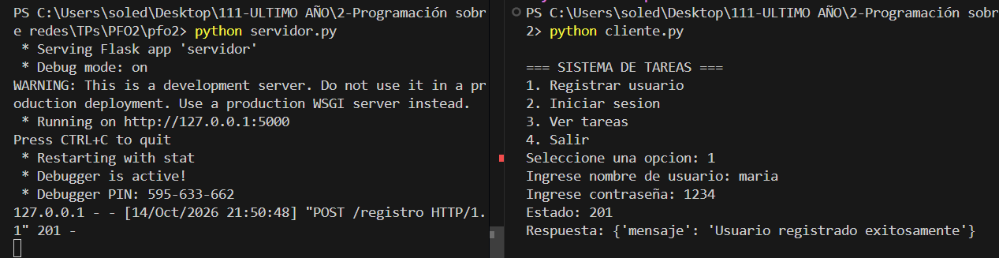
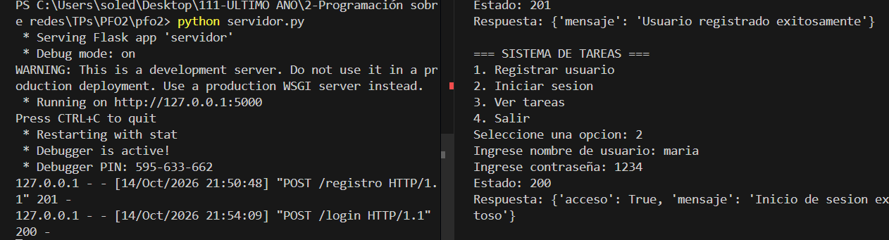
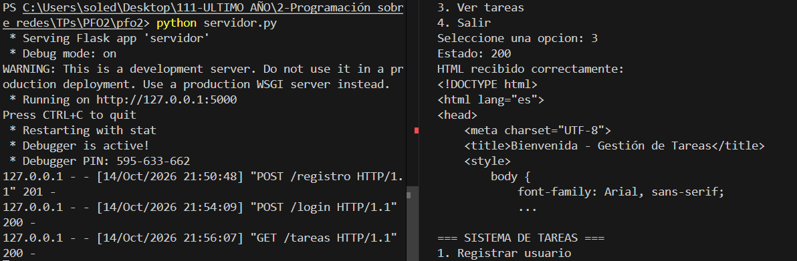
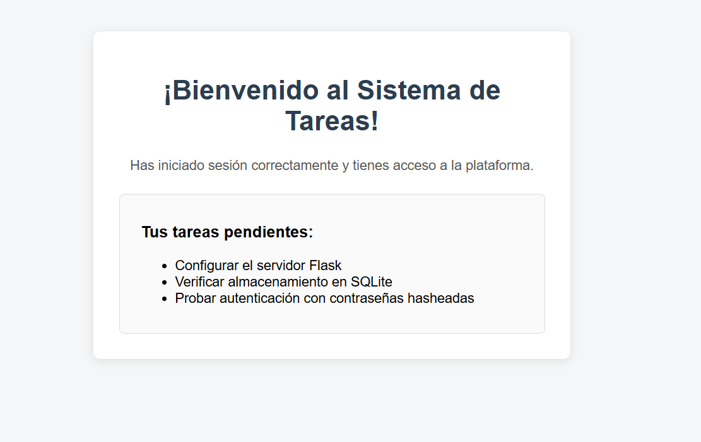
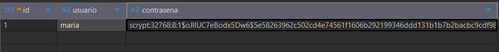

# PFO 2: Sistema de Gestión de Tareas con API y Base de Datos

Trabajo práctico de desarrollo de una API REST con Flask, persistencia en base de datos SQLite, autenticación con contraseñas hasheadas y cliente de consola interactivo.

🌐 **GitHub Pages:** [Ver proyecto en línea](https://marialopez2020.github.io/pfo2-programacion_sobre_redes/)

---

## Requisitos Previos

- Python 3.8 o superior instalado.
- Terminal o consola de comandos (PowerShell, CMD, bash).

---

## Instalación y Configuración

1. Clonar o descargar este repositorio en su computadora.
2. Abrir una terminal en la carpeta del proyecto.
3. (Opcional pero recomendado) Crear y activar un entorno virtual:
   ```bash
   python -m venv venv
   # En Windows:
   .\venv\Scripts\activate
   # En Linux/Mac:
   source venv/bin/activate
   ```
4. Instalar las dependencias necesarias:
   ```bash
   pip install -r requirements.txt
   ```

---

## Ejecución del Proyecto

### 1. Iniciar el Servidor API (Flask)
En una terminal, ejecutar:
```bash
python servidor.py
```
El servidor quedará corriendo en `http://127.0.0.1:5000`.

### 2. Iniciar el Cliente de Consola
En **otra** terminal separada (manteniendo el servidor abierto), ejecutar:
```bash
python cliente.py
```
Aparecerá un menú interactivo en consola con las siguientes opciones:
1. **Registrar usuario:** Solicita usuario y contraseña para enviarlo vía `POST /registro`.
2. **Iniciar sesión:** Solicita credenciales para enviarlas vía `POST /login`.
3. **Ver tareas:** Hace una petición `GET /tareas` y recibe el HTML de bienvenida.
4. **Salir:** Cierra el cliente.

---

## Endpoints de la API

| Método | Ruta | Descripción | Datos de entrada (JSON) |
|---|---|---|---|
| `POST` | `/registro` | Registra un nuevo usuario con contraseña hasheada en SQLite | `{"usuario": "tu_usuario", "contraseña": "tu_password"}` |
| `POST` | `/login` | Valida credenciales contra la base de datos | `{"usuario": "tu_usuario", "contraseña": "tu_password"}` |
| `GET` | `/tareas` | Muestra la página web con el HTML de bienvenida | Ninguno |

También se puede abrir la ruta `http://127.0.0.1:5000/tareas` directamente en cualquier navegador web para ver la interfaz visual.

---

## Respuestas Conceptuales

### 1. ¿Por qué hashear contraseñas?
Guardar contraseñas en texto plano representa un grave riesgo de seguridad. Si la base de datos llegara a sufrir un acceso no autorizado o una filtración, las contraseñas de todos los usuarios quedarían expuestas de inmediato.

Al aplicar una función de hash criptográfico:
- El proceso es unidireccional: a partir del hash no se puede deducir la contraseña original.
- Al verificar un login, simplemente se hashea lo que el usuario ingresó y se compara con el hash almacenado.
- Protege a los usuarios incluso si reutilizan la misma contraseña en otros sitios web.
- Ni los administradores ni los creadores del sistema tienen acceso a las contraseñas reales.

### 2. Ventajas de usar SQLite en este proyecto
- **No requiere instalación de servidor:** A diferencia de sistemas como MySQL o PostgreSQL, SQLite no corre como un servicio separado, por lo que no hace falta configurar puertos, usuarios ni permisos del motor de base de datos.
- **Portabilidad total:** Toda la base de datos vive dentro de un único archivo (`database.db`). Si se copia o traslada la carpeta del proyecto, la base de datos viaja con él sin configuraciones adicionales.
- **Integrado en Python:** SQLite viene incluido en la librería estándar de Python (`sqlite3`), lo que simplifica el desarrollo y reduce la cantidad de dependencias externas.
- **Ideal para prototipos y trabajos prácticos:** Ofrece un rendimiento rápido, seguro y confiable para aplicaciones de tamaño pequeño o mediano.


## Capturas de Pantalla de Pruebas

### Registro de usuario


### Inicio de sesión


### Vista de tareas en el navegador


### Página HTML de tareas


### Base de datos SQLite

